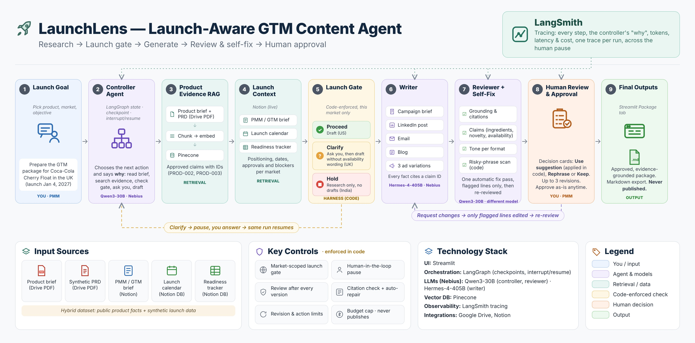
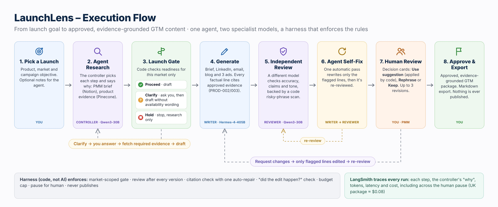

# LaunchLens

LaunchLens is a launch-aware GTM content agent: one controller agent (Qwen3-30B) chooses research steps, a Writer (Hermes-4-405B) drafts five formats, and an independent Reviewer (Qwen3-30B) checks them. A code harness enforces the launch gate, required reviews, citations and budget; LaunchLens never publishes. The demo combines public product evidence with synthetic launch/readiness data.

## Architecture and execution




## Three scenarios

- **US — Proceed:** draft a campaign brief, LinkedIn post, email, blog and three ad variations.
- **UK — Clarify:** pause for a human answer, then draft without availability wording.
- **India — Hold:** explain the launch restriction and block promotional drafting.

## Tech stack

Streamlit · LangGraph · Nebius · Pinecone · Notion · Google Drive · LangSmith

## Setup

Requires Python 3.12, uv, service access, and the demo's provisioned private evidence bindings and spending authorization. Credentials alone do not provision a runnable demo; see the [demo guide](docs/DEMO.md).

Copy `.env.example` to `.env` with permissions `0600`. Required variable names: `NEBIUS_API_KEY`, `PINECONE_API_KEY`, `PINECONE_INDEX_NAME`, `NOTION_API_KEY`. Optional tracing: `LANGSMITH_TRACING`, `LANGSMITH_API_KEY`, `LANGSMITH_PROJECT`.

Install:

```sh
uv sync --locked --no-python-downloads
uv sync --project tools/ui --locked --group offline-agent --no-python-downloads
```

Run from the repository root:

```sh
uv run --project tools/ui --locked --group offline-agent --no-python-downloads streamlit run streamlit_app.py
```

Open http://127.0.0.1:8520/.

[Demo walkthrough](docs/DEMO.md) · [Current status](docs/STATUS.md)
